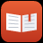

# Apps para Nintendo 3DS

Apps homebrew feitos para o Nintendo 3DS (funcionam no **Old** e no **New 3DS**). Todos se atualizam sozinhos: ao abrir, procuram
versão nova e perguntam se você quer instalar.

**Precisa de:** um 3DS com CFW ([Luma3DS](https://3ds.hacks.guide/pt_BR/)) e o FBI para instalar arquivos `.cia`.

## Os apps

| | App | O que faz | Versão | Baixar |
|---|---|---|---|---|
|  | **[Radio 3DS](https://github.com/ChunoB/Radio3DS)** | Rádios do mundo inteiro num globo 3D: gire, centralize uma cidade e ouça. Favoritos, busca, rádio-relógio com alarme e temporizador para dormir. |  | [pacote .zip](https://github.com/ChunoB/Radio3DS/releases/latest/download/Radio3DS-pacote.zip) |
|  | **[Canvas 3DS](https://github.com/ChunoB/Canvas3DS)** | O Canvas da faculdade no 3DS: cursos, tarefas e prazos, avisos, módulos, páginas, notas e mensagens. |  | [pacote .zip](https://github.com/ChunoB/Canvas3DS/releases/latest/download/Canvas3DS-pacote.zip) |
|  | **[3DS Hub](https://github.com/ChunoB/3DSHub)** | O 3DS como controle, segunda tela, sintetizador, câmera (webcam no OBS) e espelho do PC, com a biblioteca da Steam (o jogo aparece no 3DS, com som), Bichinho, Pescaria e Karaokê. Funciona em casa e longe dela, pela internet, com vários PCs pareados (até com a senha do PC, de longe): escolha o PC numa lista e toque para conectar. Vem com o programa do PC. |  | [pacote .zip](https://github.com/ChunoB/3DSHub/releases/latest/download/3dshub-pacote.zip) |
|  | **[Navegador 3DS](https://github.com/ChunoB/Navegador3DS)** | Navegador leve para sites de texto: Wikipédia, notícias, buscas e formulários, com favoritos e histórico. |  | [pacote .zip](https://github.com/ChunoB/Navegador3DS/releases/latest/download/Navegador3DS-pacote.zip) |

Os links de download e as versões sempre mostram a mais nova.

## Novidades

- **3DS Hub 1.8.1:** Steam: o som do PC chega bem mais alto no 3DS (ganho automático com limitador).
- **3DS Hub 1.8.0:** três módulos novos: Bichinho (sente o PC; aceita skins), Pescaria (o lago abre no PC, até 4 pescadores) e Karaokê (letra da música do PC e afinação pelo microfone).
- **3DS Hub 1.7.0:** Steam com som do PC no 3DS e modo Blocos (manda só o que mudou na tela).
- **3DS Hub 1.6.2:** Steam: jogos que ignoram a escala do Windows agora ocupam a tela toda.
- **3DS Hub 1.6.1:** Steam bem mais fluida e modo Retro.
- **3DS Hub 1.6.0:** a biblioteca da Steam do PC no 3DS: o jogo abre no PC e aparece na tela de cima.
- **Radio 3DS 1.2.4:** o aviso de onde o HOME travou agora aparece (embaixo e em Ajustes).
- **Radio 3DS 1.2.3:** menos travamentos (não mexe mais no chip de áudio com a opção desligada) e atualização
  mais segura. Se o app não atualizar sozinho: FBI > Remote Install > Scan QR Code com o link do `.cia`.
- **Radio 3DS 1.2.2:** HOME do próprio sistema quando o som está desligado (correção do HOME travando).
- **3DS Hub 1.5.1:** fechar pelo HOME mais rápido (Câmera, Sintetizador e rede).
- **Radio 3DS 1.2.1:** o experimento do som com a tampa fechada agora vem desligado.
- **3DS Hub 1.5:** senha fixa do PC: pareie o 3DS de qualquer lugar digitando a senha do PC.
- **3DS Hub 1.4.1:** fechar pelo HOME não trava mais na tela "fechando".
- **3DS Hub 1.4:** pareie o 3DS com o PC longe de casa: o PC mostra um código e você digita no 3DS.
- **3DS Hub 1.3.2:** vigia no PC: se o Hub do PC fechar, ele abre de novo sozinho em até 2 minutos.
- **3DS Hub 1.3.1:** fecha na hora (antes podia demorar até 20 s) e o Controle ganhou perfis para Genshin
  Impact, It Takes Two e Parsec, toque como gatilhos LT/RT e sensibilidade do analógico direito.
- **3DS Hub 1.3:** vários PCs pela internet. Pareie cada PC uma vez (na mesma rede dele) e escolha em
  Ajustes > Procurar o PC, junto com os PCs da rede.
- **3DS Hub 1.2:** use o 3DS Hub longe de casa: ele troca sozinho entre a conexão direta e a internet (túnel seguro da
  Cloudflare, sem mexer no roteador).
- **Todos os apps:** atualização pelo próprio app. Ao abrir, se tiver versão nova, aparece "Atualizar agora?".

## Como instalar

1. Baixe o pacote `.zip` do app e extraia.
2. Escolha um jeito:
   - **No HOME Menu, como um jogo:** copie o `.cia` para o cartão SD e instale pelo FBI.
   - **Pelo Homebrew Launcher:** copie o `.3dsx` para a pasta `3ds` do cartão SD.
3. Veja o `LEIA-ME.txt` de cada pacote. Alguns têm uma pasta `pc` com ferramentas para o computador.

## Atualizações

Não precisa tirar o cartão: com o 3DS na internet, o app avisa quando tem versão nova e instala com o botão A.
